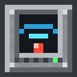
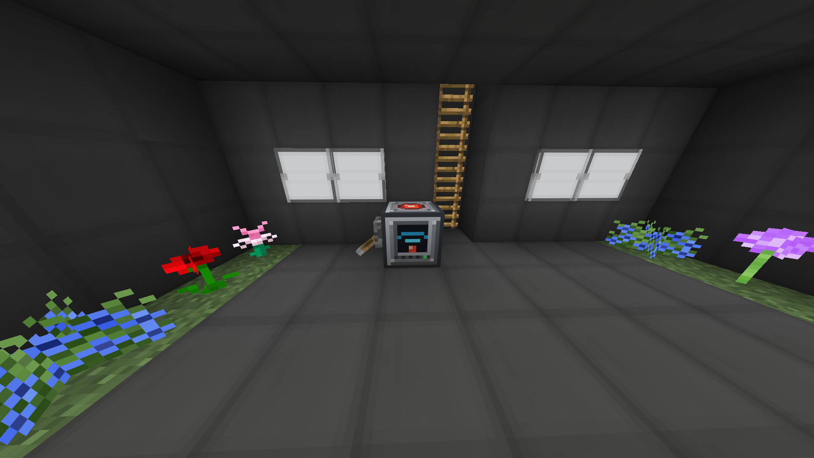
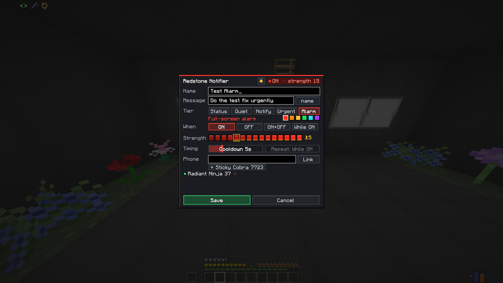
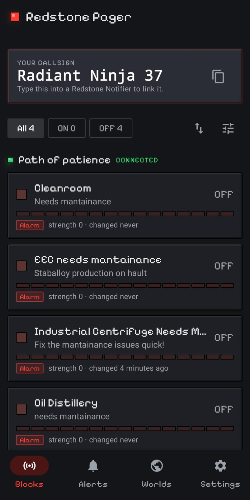
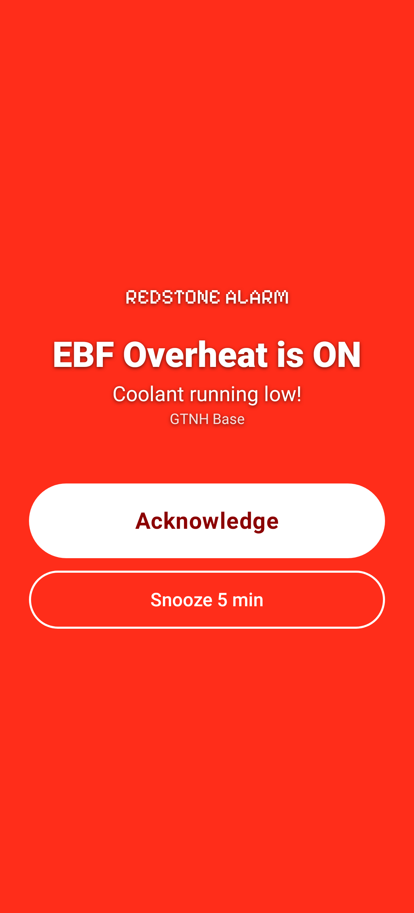
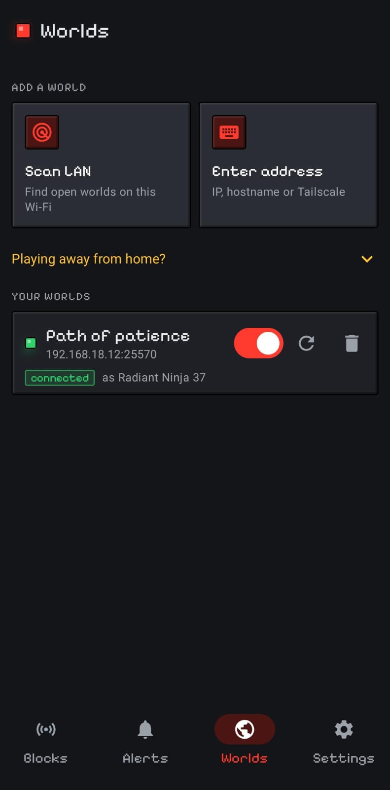
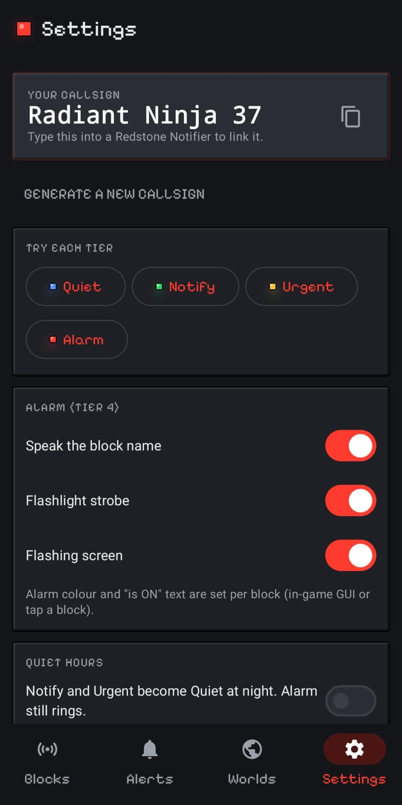

<p align="center">
  
</p>

<h1 align="center">Notify Me + Redstone Pager</h1>

<p align="center">
  <b>Get a notification on your Android phone when a redstone signal fires in Minecraft.</b><br/>
  Made for <b>GT New Horizons 2.9</b> (Minecraft 1.7.10 Forge). No cloud, no account, no server in between.
</p>

<p align="center">
  <a href="https://github.com/AnasMansha/minecraft-notify-me/releases/latest"><b>⬇ Download the latest release</b></a>
</p>

---

<p align="center">
  
  
</p>
<p align="center">
  
  
  
  
</p>

## What is it?

Two parts that work together:

| Part | What it is | File |
|---|---|---|
| **Notify Me** (mod) | Adds the **Redstone Notifier** block and a **Compact** version that sticks to any side of a block. Give it a redstone signal and it alerts your phone. | `notifyme-x.y.z.jar` |
| **Redstone Pager** (Android app) | Receives the alerts, shows every notifier and whether it's ON, and rings when it matters. | `RedstonePager-x.y.z.apk` |

Use it for things like:
- An EBF or a cleanroom that needs maintenance (GT machine covers emit redstone).
- A smeltery out of fuel.
- An ME system that's full (AE2 level emitter).
- A boiler running dry.
- Anything else that can make a redstone signal.

### Features
- **5 alert tiers per block:**
  - **Status:** only shows ON/OFF in the app.
  - **Quiet:** a silent notification.
  - **Notify:** sound and vibration.
  - **Urgent:** repeats until you acknowledge it.
  - **Alarm:** a full-screen alarm that's loud even on silent, with a flashing screen, flashlight strobe and the block's name read aloud.
- **When to alert:** when the signal turns ON, turns OFF, either, or repeat every N while ON. A **strength threshold** (1–15) and a **cooldown** stop redstone clocks from spamming you.
- **Live block list on the phone:** ON/OFF, signal strength, last change and coordinates with the dimension name. It keeps the last known state when a chunk is unloaded or the world is closed.
- **Easy linking:** each phone gets a short callsign like `Radiant Ninja 37`. Click it in the block GUI, then tap **Accept** on the phone.
- **Edit blocks from the phone:** name, message, tier, threshold, alarm colour and more.
- **Connection watchdog:** alerts you if the world disappears without closing cleanly (game crash, PC asleep).
- Quiet hours, pinned and hidden blocks, filters, alert history and acknowledging an alarm from any phone.
- **No server in between.** The phone connects straight to your Minecraft (LAN, or [Tailscale](https://tailscale.com) when you're away from home).

---

## Install (about 5 minutes)

### 1. The mod (PC)
1. Download **`notifyme-x.y.z.jar`** from the [latest release](https://github.com/AnasMansha/minecraft-notify-me/releases/latest).
2. Put it in your GTNH instance's **`mods/`** folder.
   - Prism or MultiMC: right-click the instance → *Folder* → `.minecraft/mods`
   - Multiplayer server: put it on the **server** too.
3. Start the game. The first time, **Windows Firewall** may ask about Java. Allow **Private networks**.

### 2. The app (Android 8+)
1. On your phone, download **`RedstonePager-x.y.z.apk`** from the [latest release](https://github.com/AnasMansha/minecraft-notify-me/releases/latest).
2. Open it and allow *Install unknown apps* when asked.
3. Open **Redstone Pager** and allow notifications.
4. Tap the **FIX** buttons on the yellow card:
   - **Unrestricted battery**, so Android doesn't cut the connection.
   - **Full-screen alarms**, for the Alarm tier.

### 3. Connect
1. Open your world (singleplayer works) with the phone on the **same Wi-Fi** as the PC.
2. In the app: **Worlds → Scan LAN → Add**.
3. In Minecraft, craft a **Redstone Notifier** and place it next to your redstone source.

   ```
    [Ender Pearl]
   [Redstone] [Note Block] [Redstone]
   [Iron Ingot] [Comparator] [Iron Ingot]
   ```
4. **Right-click** the block:
   1. Give it a name and message.
   2. Pick a tier.
   3. Click your phone's **+ callsign** chip.
   4. Press **Save**.
5. Click the 🔔 **bell icon** in the block GUI to send a test alert.

### Compact Redstone Notifier
A thin plate version (10×10 px, 2 px thick) that **sticks to any side of a block** like a button: walls, floors, ceilings,
or right onto a GT machine face next to its cover. It works exactly like the full block (same GUI, alerts and app support),
and pops off as an item (settings kept) if the block behind it is removed.

**Recipe:** put 1 Redstone Notifier in a crafting grid to get 1 Compact Redstone Notifier, and the other way round. The
notifier keeps its name, settings and linked phones when converted.

> **Even quicker:** link your phone in the block first. The app then pops up *"<world> wants to link this phone"*. Tap **Accept** and it's done.

---

## How to use

### The block GUI (right-click)
| Control | What it does |
|---|---|
| **Name / Message** | What the notification says, for example *"EBF Overheat: Coolant running low!"* |
| **is ON / name** | Show *"EBF Overheat is ON"* or just the name |
| **Tier** | Status · Quiet · Notify · Urgent · Alarm. For Alarm, pick the alarm screen colour with the swatches. |
| **When** | ON · OFF · ON+OFF · While ON (repeats) |
| **Strength** | Click or drag the 15-cell meter. Lit cells show the current signal; gold cells show which strengths count as ON. |
| **Timing** | Cooldown between alerts, and the repeat interval for *While ON* |
| **Phone** | Click a **+ callsign** chip, or type a callsign. Hover a linked phone to see its model and when it was last seen. |
| 🔔 | Save and send a test alert |

The block remembers its settings and links when you break it and place it again.

### Commands
| Command | |
|---|---|
| `/notifyme` | Link server status and your PC's address |
| `/notifyme list` | All notifiers and their state |
| `/notifyme phones` | Known phones |
| `/notifyme approve <callsign>` / `deny <callsign>` | Allow or remove a phone (linking it in a block also approves it) |
| `/notifyme selftest place <callsign>` · `on` · `off` · `remove` | Op only: place a test notifier at spawn and toggle redstone next to it |

### Away from home
Your phone has to reach your PC directly. The easiest way is **[Tailscale](https://tailscale.com)** (free):
1. Install it on your PC and your phone.
2. In the app: **Worlds → Enter address**.
3. Enter the PC's Tailscale IP and port **25570**.

Port forwarding works too.

### Config (`config/notifyme.cfg`)
- Link port (default **25570**, TCP)
- LAN discovery port (**25571**, UDP)
- Whether new phones need approval
- How many alerts are kept for an offline phone, and for how long
- Owner-only GUI
- Anti-spam limit

---

## Troubleshooting
| Problem | Fix |
|---|---|
| **Scan LAN finds nothing** | The world must be open, both devices on the same Wi-Fi, and Java allowed through Windows Firewall (private). Guest Wi-Fi and some routers block devices from seeing each other; use *Enter address* instead. |
| **No alerts while the phone is locked** | Settings → Permissions → **Unrestricted battery**. On Xiaomi, Samsung and similar phones, also see [dontkillmyapp.com](https://dontkillmyapp.com). |
| **The alarm isn't full-screen** | Settings → Permissions → **Full-screen alarms** (Android 14+). |
| **"awaiting approval"** | Link the phone in a notifier, or run `/notifyme approve <callsign>`. |
| **Port 25570 already in use** | Change `port` in `config/notifyme.cfg`, then add the world by address with the new port. |

---

## Build from source
| | Needs | Command | Output |
|---|---|---|---|
| Mod | JDK 21 | `cd mod && ./gradlew spotlessApply build` | `mod/build/libs/notifyme-*.jar` |
| App | JDK 17+, Android SDK (set it in `app/local.properties`) | `cd app && ./gradlew assembleDebug` | `app/app/build/outputs/apk/debug/app-debug.apk` |

More detail is in [mod/README.md](mod/README.md), [app/README.md](app/README.md) and the wire protocol in [protocol/PROTOCOL.md](protocol/PROTOCOL.md).

```
mod/        Forge 1.7.10 mod (GTNH ExampleMod / RetroFuturaGradle setup)
app/        Android app (Kotlin, Jetpack Compose)
protocol/   protocol spec, callsign word lists + reference implementation
docs/       images for this README
```

## Credits
- Build setup: [GTNewHorizons/ExampleMod1.7.10](https://github.com/GTNewHorizons/ExampleMod1.7.10) (MIT, see `mod/LICENSE-buildscript`).
- App heading font: [Pixelify Sans](https://github.com/eifetx/Pixelify-Sans) (SIL OFL 1.1).
- Block textures and the app icon are original pixel art (`mod/tools/gen_textures.py`).
- Not affiliated with Mojang, Microsoft or the GT New Horizons team.

## License
[MIT](LICENSE)
